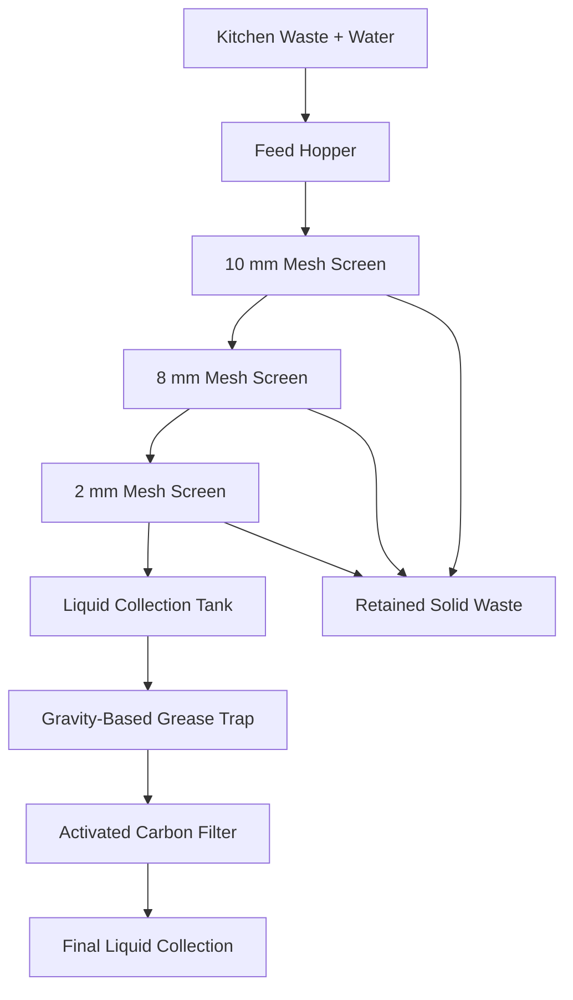

# VibraSep — System Architecture

## 1. Architecture Overview

VibraSep follows a sequential physical-treatment architecture. Kitchen waste slurry passes through a multi-stage screening assembly, followed by gravity-based grease separation and activated carbon filtration.

## 2. Process Flow Diagram

## 3. Functional Modules

### Module 1 — Feeding
Receives the kitchen waste slurry and directs it onto the upper screen.

### Module 2 — Solid–Liquid Separation
Uses three mesh screens arranged from coarse to fine. Screen vibration is intended to improve material movement and drainage.

### Module 3 — Liquid Collection
Collects the screened liquid and directs it to the grease trap.

### Module 4 — Oil and Grease Separation
Uses gravity and density differences to separate floating free oil and grease.

### Module 5 — Activated Carbon Filtration
Uses adsorption to reduce some dissolved organic impurities and odour-causing compounds.

### Module 6 — Output and Maintenance
Collects the treated liquid and allows periodic removal of solids, grease, and spent carbon.

## 4. Inputs and Outputs

**Input:** Kitchen waste mixed with water.

**Solid output:** Screen-retained food particles for suitable handling or further assessment.

**Grease output:** Separated free oil and grease from the trap.

**Liquid output:** Screened, grease-separated, and carbon-filtered liquid requiring quality testing and potentially further treatment.

## 5. Key Design Considerations

- Screen aperture and open area.
- Vibration frequency, amplitude, and structural mounting.
- Feed rate and liquid recovery.
- Screen clogging and ease of cleaning.
- Grease-trap retention time and separation performance.
- Activated carbon quantity, contact time, and replacement interval.
- Leak prevention, corrosion resistance, and operator safety.

## 6. Validation

Evaluate each stage independently and as a complete system. Record mass balance, liquid recovery, suspended solids, oil and grease concentrations, flow rate, cleaning time, and consumable costs.

All performance claims must be supported by measured results. This architecture represents the proposed design and does not establish validated treatment performance.

